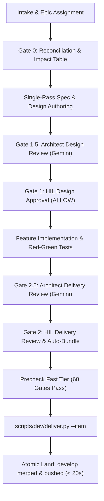

# Product Forge — Comprehensive Architecture, Workflow & Operational Reference

**Document Version:** 1.0 (Canonical Reference)  
**Scope:** Plane A (Product Forge Self-Build / `product_forge`) & Plane B (Product Forge Generated Products / `project`)  
**Authority:** Single Source of Truth synthesized from `AGENTS.md`, `docs/STRUCTURE-CONTRACT.md`, `docs/REVIEW-GATES-LIFECYCLE.md`, `docs/WORK-EXECUTION-CONTRACT.md`, `docs/ENGINEERING_OPERATING_STANDARD.md`, and `config/store-registry.json`.

---

## 1. System Architecture & Foundation

### 1.1 The Two Delivery Planes
| Dimension | Plane A (PF-SB / Self-Build) | Plane B (PF-GP / Generated Products) |
|---|---|---|
| **Goal** | Builds and enhances Product Forge itself | Product Forge builds customer software products |
| **Backlog Scope** | `product_forge` (`data/backlog/` + Postgres DB) | `project` (`products/<project>/backlog/`) |
| **Integration Branch** | `develop` (in `product-forge` repo) | Per-project git repository `develop` branch |
| **Execution Loop** | Interactive developer / AI coding session | Autonomous pipeline stages (`core/pipeline_executor.py`) |
| **Runtime Adapters** | OpenCode, Antigravity, Codex (optional adapters) | Product Forge WorkerGrid (`go/capsvc`, `go/edpsvc`, Python workers) |

---

### 1.2 Technology Boundaries (Go vs Python)
- **Go by Default (Core & Sensitive Logic):**
  - Event Bus & Dispatcher (`go/eventtransport/`, `go/pfcore/`, monotonic sequences, at-least-once, retry -> DLQ).
  - Enterprise Data Plane (`go/edpsvc/`, Postgres SoR, `/backlog` REST endpoint, port 8030).
  - Object Store & Policies (`go/objstore/`, `go/objpolicy/`, S3/GCS adapters, deduplication).
  - High-concurrency worker scheduling, lease management, and cryptographic signing (Ed25519, HMAC).
- **Python (Tooling, Clients & Shims):**
  - Existing shipped modules in `core/` (edits allowed, no new unbounded modules).
  - Developer CLI tools & audit scripts (`scripts/dev/`, `scripts/pipeline.py`).
  - Test suite (`test-framework/`, `tests/`, `pytest`).
  - Thin client bridges (`core/events.py`, `core/backlog.py`) querying Go services over HTTP/Unix sockets.

---

### 1.3 Backlog Data Layer & Authentication
- **Dual Storage Model:**
  - **Primary System of Record (SoR):** PostgreSQL accessed via Go `edpsvc` (`http://127.0.0.1:8030/backlog?tenant=product_forge`).
  - **Git Disk Mirror:** `data/backlog/items/<ID>.json`, `data/backlog/open.json`, `data/backlog/closed.json`, `data/backlog/history/<ID>.jsonl`.
- **Environment Variables Required:**
  - `$env:PF_EDP_TOKEN = 'pf-edp-local-token-32-chars-long'` (Bearer auth for backlog API).
  - `$env:PF_ADMIN_TOKEN = 'pf-edp-local-token-32-chars-long'`.
  - `$env:PF_EDP_API_URL = 'http://127.0.0.1:8030'` (default).
  - `$env:PF_BACKLOG_DB = 'off'` (optional: forces pure local JSON disk file mode when daemon is stopped).
  - `$env:GEMINI_API_KEY = '<key>'` (Required for Architect review Gate 1.5 & Gate 2.5).

---

### 1.4 Golden Rules of Repository Structure
1. **One truth per concern, one writer per file:** Only the declared owner module in `config/store-registry.json` writes a file.
2. **Work items live strictly in the backlog:** Never create `.md` task lists or standalone task trackers. Work is tracked in `core/backlog.py`.
3. **Every item belongs to an Epic (`BI-PF-####`):** Unparented items fail the precheck gate (`scripts/dev/backlog_epic_audit.py`).
4. **Git Pre-Commit Hook Separation (IS-PF-0036):** Source code, specs, and review evidence must **never** be committed in the same git commit as `data/backlog/**`. They must be two distinct sequential commits.
5. **No direct commits to `develop` or `main`:** All work happens on feature branches `feat/<ID>-<slug>`. Direct commits are rejected by `.git/hooks/pre-commit`.

---

## 2. End-to-End Item Lifecycle & Review Gates



### Stage 1: Intake & Gate 0 (Reconciliation)
1. **Find Parent Epic:** Query parent epic (e.g. `BI-PF-1265`).
2. **Deduplication Check:** `python -m core.backlog --similar "<title/description>"`.
3. **Branch Creation:** `git checkout -b feat/<item-id>-<short-slug>`.
4. **Language Rule Review:** `python scripts/dev/language_rule_review.py <ID>` (Verifies Go vs Python sizing).
5. **Reconciliation Block:** Worker authors 5 sections:
   - `PRIOR DECISIONS` (explicit citations).
   - `EXISTING PATH` (code files and line numbers).
   - `ASSUMPTIONS` (no unconfirmed assumptions).
   - `DIVERGENCES` (explicitly justified).
   - `OPEN QUESTIONS` (must be empty before coding).
6. **Impact Table:** Authors claims for `LANGUAGE CHECK`, `API CHECK`, `AC CHECK`.
7. **Verification:** `python scripts/dev/gate0_check.py` -> `OK`.

---

### Stage 2: Synchronous Spec & Design Authoring
Before Gate 1.5, three durable artifacts are generated in a single pass:
1. **Functional Spec:** `engineering/specs/<ID>.md` (enforces `config/functional-spec.json`).
   - Must include `FR-x`, preconditions, inputs, outputs, errors, acceptance, and file evidence paths in `traceability`.
2. **Spec Pack:** `engineering/specs/<ID>-spec-pack.md` (enforces `config/spec-pack.json`).
3. **Design Pack:** `engineering/design/<ID>.md` (enforces `config/design-pack.json` & `config/design-completeness.json`).
   - Must populate all 27 design dimensions (runtime contract, security model, controls matrix, performance, rollback, invariants, etc.).
   - `controls`: Each control (`C-x`) requires `id`, `dimension`, `applies_to`, `check` (starts with `pytest` or `go test`), `evidence`, `failure_behavior`, and `owner`.
   - `performance`: Explicit performance objective.

**Verification Suite:**
```powershell
python scripts/dev/spec_contract.py --item <ID>
python scripts/dev/functional_spec.py --item <ID> --check
python scripts/dev/spec_pack.py --item <ID> --check
python scripts/dev/design_pack.py --item <ID> --check
python scripts/dev/design_contract_check.py --item <ID>
python scripts/dev/design_completeness_check.py --item <ID>
python scripts/dev/biis_tier_check.py
python scripts/dev/ownership_check.py
```

---

### Stage 3: Gate 1.5 & Gate 1 (Design Approval)
1. **Gate 1.5 Architect Review:**
   ```powershell
   python scripts/dev/architect_review.py run --item <ID> --mode design --apply
   ```
   - Model: `gemini-2.5-flash` via Google Generative Language OpenAI-compatible API.
   - Generates: `engineering/reviews/<ID>-<design-sha>.json`.
2. **Disposition Findings:**
   - Every finding (BLOCKER, MAJOR, MINOR, NIT) must be set to `ACTIONED` with a concrete file citation:
     `item["review_dispositions"]["design"][sig] = {"status": "ACTIONED", "note": "...", "by": "hil:operator"}`
3. **Record Gate 1 Decision:**
   ```json
   {
     "at": "<ISO-timestamp>",
     "by": "hil:operator",
     "seq": 1,
     "gate": 1,
     "decision": "APPROVE",
     "findings_sha": "<design-sha>",
     "findings_digest": "<digest>",
     "hil_confirmed": true
   }
   ```
4. **Transition Gate Verification:**
   ```powershell
   python scripts/dev/gate1_transition_check.py
   ```
   - Must output: `gate1: ALLOW item=<ID> reason=OK sha=<design-sha>` and `gate1-transition: OK`.
   - Item status transitions to `in_progress`.

---

### Stage 4: Implementation & Test Verification
1. Implement changes in accordance with language rule: Go for new logic, Python edits for existing modules/tools.
2. Author contract tests in `test-framework/tests/pipeline/` or `tests/`.
3. Verify tests pass:
   ```powershell
   python -m pytest <test-path>
   ```
4. Stage and commit source code and tests (never mix with `data/backlog/`):
   ```powershell
   git add <source-and-test-files>
   git commit -m "feat(<scope>): <ID> <description>"
   ```

---

### Stage 5: Gate 2.5 & Gate 2 (Delivery Approval)
1. **Gate 2.5 Delivery Review (Diff Mode):**
   ```powershell
   python scripts/dev/architect_review.py run --item <ID> --mode diff --apply
   ```
   - Generates: `engineering/reviews/<ID>-<diff-sha>.json`.
2. **Disposition Delivery Findings:**
   - Action all findings in `review_dispositions["diff"]` with file citations.
   - If findings include a BLOCKER or MAJOR, populate `fix_impact` on the item conforming to `config/fix-impact.json` and verify with:
     ```powershell
     python scripts/dev/fix_guard.py --item <ID>
     ```
3. **Commit Review Evidence:**
   ```powershell
   git add engineering/reviews/ engineering/specs/ engineering/design/ engineering/trails/
   git commit -m "docs(review): record Gate 1.5 & Gate 2.5 review evidence with Gemini for <ID>"
   ```
4. **Auto-Bundle Item Finalization:**
   ```powershell
   python scripts/dev/finalize_item.py --item <ID> --auto-bundle
   ```
   - Automatically bundles AC verification (`PASS`), DoD evidence, Gate 2 decision, final report, and trail milestones.
5. **Verify Delivery Gates:**
   ```powershell
   python scripts/dev/gate2_completion_check.py
   python scripts/dev/architect_review_check.py
   python scripts/dev/conformance_check.py --item <ID>
   ```

---

### Stage 6: Precheck Fast Band (60 Automated Gates)
Run the offline deterministic gate suite:
```powershell
python scripts/dev/precheck.py
```
Precheck executes 60 gates across 6 categories:
1. **Structure:** `compile`, `pycompat`, `ci-cd-gates`, `wired-audit`, `store-contract`, `store-registry`, `lint`, `encoding`, `branch-item`.
2. **Security:** `secret-scan`, `language-rule`, `compliance-register`, `data-plane-threats`.
3. **Contracts:** `api-first`, `api-contract`, `api-governance`, `task-contract`, `spec-contract`, `functional-spec`, `spec-pack`, `design-pack`, `conformance`.
4. **Quality:** `fix-guard`, `review-budget`, `validation-engine`, `feature-pr`, `merge-gate`, `architect-review`, `rate-budget`, `tests-scoped`.
5. **Backlog Invariants:** `backlog-scope`, `backlog-reconcile`, `backlog-context`, `backlog-dod`, `backlog-verification`, `backlog-ids`, `backlog-epic`, `backlog-monotonic`, `backlog-write`.
6. **Lifecycle:** `gate0`, `gate1-transition`, `gate2-completion`, `delivery-completeness`.

---

### Stage 7: Atomic One-Command Landing (`scripts/dev/deliver.py`)
Once precheck is green, execute:
```powershell
python scripts/dev/deliver.py --item <ID>
```
**Automated Execution (< 20 seconds):**
1. Inspects git status and branch safety (blocks execution from `develop`/`main`).
2. Auto-bundles AC verification and generates final report.
3. Automatically commits `data/backlog/` separately from source code.
4. Executes pre-merge verification (`sync_develop.py` and `wired_audit.py`).
5. Checks out `develop`, merges the feature branch with `--no-ff`.
6. Pushes `develop` to `origin/develop`.
7. Stamps delivery provenance (`core.backlog.set_delivery`) with `merge_sha` and `branch`.
8. Deletes the local feature branch and returns clean JSON.

---

## 3. Tool & Script Inventory Reference

| Script | Purpose | Common Invocation |
|---|---|---|
| **`scripts/dev/deliver.py`** | **One-command Plane A delivery runner** | `python scripts/dev/deliver.py --item <ID>` |
| **`scripts/dev/finalize_item.py`** | Stamps AC verification, DoD, and final report | `python scripts/dev/finalize_item.py --item <ID> --auto-bundle` |
| **`scripts/dev/architect_review.py`** | LLM Architect Review (Gemini 2.5 Flash) | `python scripts/dev/architect_review.py run --item <ID> --mode {design,diff} --apply` |
| **`scripts/dev/precheck.py`** | CI/CD Precheck gate suite (60 gates) | `python scripts/dev/precheck.py` |
| **`scripts/dev/gate0_check.py`** | Validates Gate 0 reconciliation & impact table | `python scripts/dev/gate0_check.py` |
| **`scripts/dev/gate1_transition_check.py`** | Validates Gate 1 design approval before coding | `python scripts/dev/gate1_transition_check.py` |
| **`scripts/dev/gate2_completion_check.py`** | Validates Gate 2 delivery approval & completion | `python scripts/dev/gate2_completion_check.py` |
| **`scripts/dev/architect_review_check.py`** | Offline check that diff has committed Gate 2.5 review | `python scripts/dev/architect_review_check.py` |
| **`scripts/dev/conformance_check.py`** | Checks traceability between FRs, tests, and evidence | `python scripts/dev/conformance_check.py --item <ID>` |
| **`scripts/dev/fix_guard.py`** | Validates fix impact records for BLOCKER/MAJOR findings | `python scripts/dev/fix_guard.py --item <ID>` |
| **`scripts/dev/language_rule_review.py`** | Evaluates Go vs Python size and language rule | `python scripts/dev/language_rule_review.py <ID>` |
| **`scripts/dev/wired_audit.py`** | Verifies zero unwired modules and zero naming violations | `python scripts/dev/wired_audit.py` |
| **`scripts/dev/sync_develop.py`** | Merges origin/develop cleanly into current branch | `python scripts/dev/sync_develop.py` |
| **`scripts/dev/spec_contract.py`** | Validates spec contract conformance | `python scripts/dev/spec_contract.py --item <ID>` |
| **`scripts/dev/functional_spec.py`** | Validates/renders functional specification | `python scripts/dev/functional_spec.py --item <ID> --check` |
| **`scripts/dev/design_pack.py`** | Validates/renders durable design pack | `python scripts/dev/design_pack.py --item <ID> --check` |
| **`scripts/dev/lint_check.py`** | Fast ruff linter scoped to changed files | `python scripts/dev/lint_check.py` |
| **`scripts/dev/encoding_check.py`** | Checks for invalid UTF-8 or unexpected BOMs | `python scripts/dev/encoding_check.py` |

---

## 4. Key Configuration Files (Registry & Policies)

| Configuration Path | Concern / Policy |
|---|---|
| **`config/architect-review.json`** | Model endpoint (`gemini-2.5-flash`), base URL, API key env (`GEMINI_API_KEY`). |
| **`config/store-registry.json`** | Single Source of Truth for all data stores, visibility tiers, and owner modules. |
| **`config/ci-cd-gates.json`** | Registry of all CI/CD gates, scripts, categories, and execution tiers. |
| **`config/control-matrix.json`** | Required fields and check prefixes for design controls (`C-x`). |
| **`config/fix-impact.json`** | Required fields and origin classes for remediation records. |
| **`config/spec-contract.json`** | Enforcement thresholds and schemas for functional specs and design packs. |
| **`config/functional-spec.json`** | Required sections and validation rules for `engineering/specs/<ID>.md`. |
| **`config/design-completeness.json`** | 27 required dimensions for durable design packs. |
| **`config/ownership.json`** | Glob patterns mapping file paths to architectural ownership domains. |

---

## 5. Summary Cheat Sheet for Workers

```powershell
# 1. Environment Setup (per session)
$env:PF_EDP_TOKEN = 'pf-edp-local-token-32-chars-long'
$env:PF_ADMIN_TOKEN = 'pf-edp-local-token-32-chars-long'

# 2. Start Work on Feature Branch
git checkout -b feat/<item-id>-<slug>
python scripts/dev/language_rule_review.py <item-id>

# 3. Compile Specs & Design (Gate 0 -> Gate 1.5 -> Gate 1)
python scripts/dev/gate0_check.py
python scripts/dev/architect_review.py run --item <item-id> --mode design --apply
# (Disposition findings & record Gate 1 decision)
python scripts/dev/gate1_transition_check.py

# 4. Implement Code & Verify Tests
python -m pytest <test-path>
git add <source-files> <test-files>
git commit -m "feat(<scope>): <item-id> implementation"

# 5. Delivery Review (Gate 2.5 -> Gate 2)
python scripts/dev/architect_review.py run --item <item-id> --mode diff --apply
# (Disposition findings, stage review JSON, commit)
git add engineering/reviews/ engineering/specs/ engineering/design/ engineering/trails/
git commit -m "docs(review): record Gate 1.5 & Gate 2.5 review evidence for <item-id>"

# 6. Verify Precheck
python scripts/dev/precheck.py

# 7. Atomic Delivery (One Command Landing in < 20s)
python scripts/dev/deliver.py --item <item-id>
```
